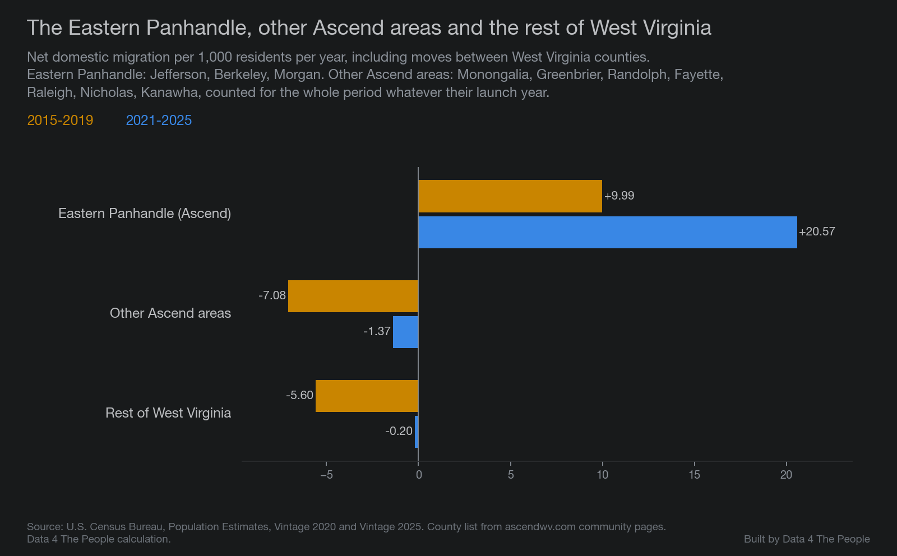

---
title:
subtitle:
slug: west-virginia-ascend
date: 2026-11-19
section: Data 4 Thought
hero: images/west-virginia-ascend-hero-1680x1080.png
hero_alt:
meta_title:
description:
keywords:
schema_type: article
drop_cap: true
heading_spacer: 20px
caption_spacer: 20px
dividers: false
---

# Title

Over the last two days we followed the money on JobsOhio. We first built a public tool to track its grants, understand who gets the money, and what happened to it. We then followed this up by studying [where the money went](https://www.data4thepeople.com/p/ohio-income-health).

One of the main takeaways is that JobsOhio has given out a boatload of grants, but when you look at the dollars, the program has given a disproportionate amount of money to large corporations who are promising to create loads of jobs in one shot.

There is a term for this strategy in business. It’s called whale hunting. You go after the “whales” hoping to harpoon one that can bring in a bunch of revenue, or in this case, jobs. But, as we learned earlier this week, an economic development strategy that is based on whale hunting is a risky sport. It can end in grantees issuing mass layoffs, closing the funded site, going bankrupt, subject to lawsuits for nonperformance, or just never building the facility they signed up to build. It’s a strategy where you live or die with concentration risk. For example, if Intel can’t land “a significant external customer” for its 14A chipmaking process, in its own words, “we may pause or discontinue development of Intel 14A ... For example, we would likely discontinue the new leading-edge fabrication facilities we are building in Ohio.” Ohio has pushed at least $839.4 million worth of “chips” ($125.4 million from JobsOhio) onto the table through June 2025, out of a package reported at about $2.1 billion, betting on whatever a 14A process is. That’s one big, concentrated bet on a very nuanced thing in a fast-changing chip market where, by Intel’s own account, AI spending is driving demand.

Anyway, that’s one way to do it.

But there is an entire spectrum of other ways to approach economic development. Today’s post is about one of the most interesting ones we have come across, which just happens to be in Ohio’s neighbor, West Virginia. It’s called the Ascend program, and we are focusing on it today because it’s about as different from JobsOhio as a program could be. Instead of trying to hunt whales, Ascend is going after individuals. Literally, one person and family at a time! It provides an incentive directly to a worker to relocate to West Virginia, and bring their very healthy income to the community to which they move. It’s the other economic development bookend sitting on the opposite side of the bookshelf. The yin to Ohio’s yang. That alone made it fascinating to us, and set us off on our exploration of the program. Here is what we found.

## What Ascend is, in its own words
::: spacer 5px

Ascend WV opened applications on April 12, 2021. It is run by West Virginia University's Brad and Alys Smith Outdoor Economic Development Collaborative, and it pays remote workers to move to one of six parts of the state. The offer is $12,000 in cash, paid monthly over two years, plus free outdoor gear and recreation. The program values the full package at "more than $20,000."

To join, a person must work remotely full time or be self-employed. Before they are accepted, applicants must "provide evidence of employment and income," such as a recent paystub or tax documents, and an employer must confirm the job.

The program started in the Morgantown area in April 2021. It has since added the Eastern Panhandle (June 2022), Greenbrier Valley (September 2022), Greater Elkins (November 2022), New River Gorge (June 2023) and Charleston (September 2025). In September 2021, it said it would bring more than 1,000 remote workers to the state within five years.

Here is where the program stands by its own count. As of September 30, 2026, WVU reports:

- 827 members, the remote workers themselves, or 82.7% of that goal
- 1,641 new West Virginians, counting family members and 25 babies born during the program
- 184 members who have finished the two-year program
- a 96% retention rate, which WVU defines as members who stayed after at least four months in the program
- more than 94,400 applications

The program has released counts like these every few months since its first class. The chart below shows each one on the date it came out.

*Source: Ascend WV and WVU releases and statistics, and news reports quoting them. WVU shared its Q3 2026 statistics with Data 4 The People.*

Ascend also publishes the average salary of its members in each community. As of September 2026, the averages ranged from $82,122 in the Charleston area to $110,020 in the Eastern Panhandle.

## West Virginia started gaining people from other states
::: spacer 5px

For most of the last decade, more people moved from West Virginia to other states than moved in. In the five years from July 2014 to July 2019, the state lost 39,847 people this way, on net. That turned around in the year ending July 2021. West Virginia has gained people from other states every year since, a total of 17,349 through July 2025. The chart below shows this net domestic migration for each year.

*Source: U.S. Census Bureau, Population Estimates, Vintage 2020 and Vintage 2025.*

That was one of the largest turns in the country. Per resident, West Virginia's change from 2015-2019 to 2021-2025 ranks third among the 50 states and D.C., at 6.34 more people per 1,000 residents a year. Ohio ranks 31st. The next chart shows the ten states with the largest turn, plus West Virginia's neighbors.

*Source: U.S. Census Bureau, Population Estimates, Vintage 2020 and Vintage 2025. Data 4 The People calculation.*

Most of West Virginia's gain went to one corner of the state. The three Eastern Panhandle counties, Jefferson, Berkeley and Morgan, gained 21,680 people through moves from 2021 to 2025. That is more than the state's total of 17,349. Without them, the rest of West Virginia lost 4,331 people, on net. County figures also count moves from one West Virginia county to another; those cancel out in the state total.

The Panhandle was already gaining people before Ascend arrived. The next chart compares it with the other Ascend areas and the rest of the state, per 1,000 residents a year.

*Source: U.S. Census Bureau, Population Estimates, Vintage 2020 and Vintage 2025. County list from ascendwv.com community pages. Data 4 The People calculation.*

All three groups gained ground. The Eastern Panhandle went from 9.99 to 20.57 per 1,000 residents a year. The other Ascend areas went from -7.08 to -1.37, and the rest of the state went from -5.60 to -0.20.

## Ascend is too small to explain the change
::: spacer 5px

We checked whether Ascend is large enough to account for these changes. Suppose every one of the 421 people Ascend reports in the Eastern Panhandle had arrived by July 2025. They would add about 0.4 people per 1,000 residents a year. The Panhandle's rate rose by 10.59. In the other Ascend areas, Ascend's 1,224 reported residents would add about 0.5, against a rise of 5.72. Counties without Ascend rose by 5.41.

Ascend's members are too few to explain the change in its areas. These numbers cannot tell us what would have happened without the program, and we did not try to estimate that.

## One is measurable, one is not
::: spacer 5px

Being too small to move the state's totals is a different question from whether the program is a good use of money. Here, the two states' approaches look very different. The table below lines them up.

![Table comparing Ascend WV and JobsOhio grants. What the state pays: $12,000 in cash to the worker, paid monthly over 24 months, versus $16,182 in grants per committed new job, 2021 to 2025. Does the job exist when the deal is made: yes, members show proof of employment and income first, versus not yet, the company commits to create it. What pay is published: members' average salary by community, versus the payroll the company promised. What the public can check later: members, completions and retention in WVU's reports, versus only signs of failure such as layoff notices, bankruptcies and lawsuits.](images/07-two-ways-table.png)
*Ascend's $12,000 is its cash incentive only; total program cost per member is not published.*

Start with the job. To join Ascend, a worker shows proof of employment and income, and the employer confirms the job. The job exists before the state commits a dollar. A JobsOhio grant works the other way. The company commits to create jobs in the future, and the grant is made on that commitment. A JobsOhio job is a promise. An Ascend member brings a job with them.

Then the pay. Ohio publishes the pay it was promised for jobs that don't exist yet. Ascend publishes the pay of jobs its members already have. The next chart puts those numbers next to each state's average wage.

*Sources: WVU Smith OEDC, Ascend WV Q3 2026 statistics; JobsOhio monthly executed grant reports; U.S. Bureau of Labor Statistics, OEWS May 2025. Data 4 The People calculation.*

Weighting each community by its number of members, Ascend members earn an average of $96,052. That is about 70% above West Virginia's average wage of $56,470. Companies that signed JobsOhio grants from 2021 to 2025 promised an average of $66,689 per new job, about 4% above Ohio's average wage of $64,390. Ascend checks pay when members apply; WVU does not say whether the averages are updated after members arrive.

Then the cost. Ascend pays each member $12,000 in cash. JobsOhio's grants from 2021 to 2025 came to $16,182 per committed job. WVU does not publish what the whole program costs per member, so these two numbers are not a full comparison of cost.

Last, what happens after the money goes out. WVU reports how many members are still in the program and how many have finished it. For JobsOhio, as we found when we built [our grants tool](https://www.data4thepeople.com/p/jobsohio-grants), there is no success column. The public can see some failures, through layoff notices, bankruptcies and lawsuits. It cannot see a project that was never built.

Neither program measures how many workers or companies would have come anyway.

[my conclusion. I will write after I see what you have done]
